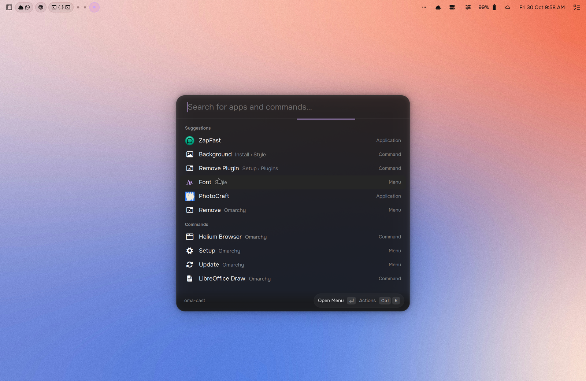

# Pond for Omarchy

An [Omarchy](https://omarchy.org) theme that brings the look and feel of
**[Pond](https://github.com/bflycomputer/pond-interface)**, the desktop by
[Butterfly](https://butterfly.so), to Omarchy's Hyprland + Quickshell desktop.



> Unofficial. This is a fan port of Pond's design to Omarchy and is not made,
> endorsed or supported by Butterfly Interaction Inc.

## Install

```sh
omarchy theme install https://github.com/chacechin/omarchy-pond-theme
omarchy theme set pond
```

## What you get

| | |
|---|---|
| **Shell** (`shell.toml`) | Pond's neutral greys (`#1D1D1D` panels, `#3D3D3D`/white-10% outlines, `#262626` hover), lavender accent `#CBA6F7`, lime "on" state `#B0FF4F`, Pond's 44px panel rows, and frosted glass: translucent panels, menus, notifications and launcher over Hyprland blur |
| **Windows** (`hyprland.lua`) | 12px corners (Pond's `geometry-corner-radius`), Pond's focus ring as the active border (`#8a8a8a99`) with no outline on unfocused windows, opaque windows, Pond's motion (200ms ease-out open/close, emphasized-decelerate moves and workspace slides, 220ms panel fades), and layer blur for the shell's floating surfaces |
| **Colours** (`colors.toml`) | Pond's neutral surfaces with Kanagawa ANSI colours, so every Omarchy-themed app follows |
| **Terminal** (`kitty.conf`) | Pond's kitty palette (Kanagawa), 70% background over blur, JetBrains Mono, kitty's plain `fade` tab bar |
| **Icons** (`icons.theme`) | Adwaita, as on Pond |
| **Wallpapers** (`backgrounds/`) | A soft gradient photo by default, plus six stills of Pond's daylight sky (midday, afternoon, dusk, night, dawn, morning) rendered from Pond's sky shader |

## Notes

- **Kitty font, tabs and opacity.** Omarchy includes the theme's `kitty.conf` at
  the top of `~/.config/kitty/kitty.conf`, so your own settings below that line
  win. To let the theme set them, put your own defaults for
  `background_opacity`, `font_family`, `tab_bar_style` and `tab_powerline_style`
  *above* the `include` line. The font needs `JetBrainsMono Nerd Font`.
- **OmaControl.** The theme re-applies its rounding and animations after the
  whole Hyprland config loads, so it still wins if OmaControl writes its own.
- **Top gap.** Under Pond the top window gap is 0. The bar's strip already
  reads as margin, so the space under the bar matches the other sides.
- **Not included.** Pond's Onest UI font for the shell, its SVG icons in shell
  widgets, and the launcher and widget restyles in the preview are personal
  shell plugins and fontconfig tweaks, not part of an Omarchy theme.

## Credits

- **Pond** by [Butterfly](https://butterfly.so)
  ([bflycomputer/pond-interface](https://github.com/bflycomputer/pond-interface),
  BSD 3-Clause, © 2026 Butterfly Interaction Inc.). The colours, sizes and
  motion come from Pond's source, the sky wallpapers are rendered with a port
  of Pond's daylight shader, and the launcher values come from
  [bflycomputer/vicinae](https://github.com/bflycomputer/vicinae).
- **Kanagawa** palette by [rebelot](https://github.com/rebelot/kanagawa.nvim)
  (MIT), used by Pond's kitty theme.
- **Default wallpaper** photo by
  [Plufow Le Studio](https://unsplash.com/photos/lRcPeX_5zUQ) on Unsplash,
  under the [Unsplash License](https://unsplash.com/license).

## License

BSD 3-Clause. See [LICENSE](LICENSE), which carries Pond's copyright notice
alongside this theme's.
